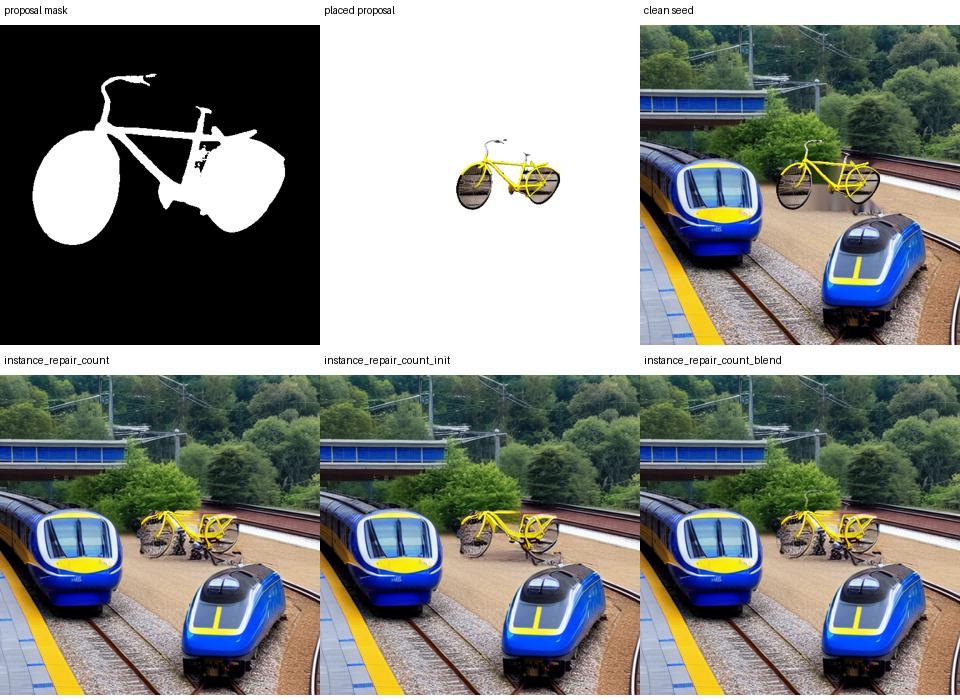

# Clean-canvas diagnostic: no convincing shape fix; foreground contamination exposed

Run `20261103T010052Z_be837def`, code `4cb0535`, L4 22 GB. Both supplied ZIPs are complete within the export contract: all **75 exported manifest artifacts**, including 53 PNGs, pass SHA-256. Four omitted `_objects` cache entries are expected; the new diagnostic copies expose the selected proposal/mask without that cache. All four final method/scene/seed rows are present and unique. This is one deliberately selected development scene, not held-out evidence.

## Within-run results

| Variant | Class-count error | Box mIoU | Relation accuracy | Joint box-layout success | Sampling work |
|---|---:|---:|---:|---:|---:|
| Original count replacement | 0 | .81991 | 1 | 1 | 280 |
| Clean initialization only | 0 | .80665 | 1 | 1 | 280 |
| Clean final blend only | 0 | .73712 | 1 | 1 | 280 |
| Both clean changes | 0 | .73340 | 1 | 1 | 280 |

OPR remains 1 in every arm. [Unmodified per-image metric values](CLEAN_20261103_METRICS.csv) are retained. None of the clean changes improves mIoU. CLIP increases from 32.97 to 33.71 in the combined arm, but this does not certify shape/naturalness. All count/joint endpoints pass while the bicycle still looks malformed. No significance test or confidence interval is meaningful here.

Recorded reconstructed standalone times are about 72.04/58.92/58.87/58.99 seconds in table order. Shared initialization, M2 timing and warmup confound these one-image values; do not conclude cleanup accelerates inference. Clean-init adds one VAE encode and cleanup adds CPU work even with unchanged sampling counts.

## Ablation integrity

All four arms have identical initial pixels, proposal pixels, edit mask, target/extras, M2 key/subset, configuration and seed. Recomputed standalone sampling work is 280 in every arm. Each final is the accepted candidate. Every pixel outside the permitted mask, including both requested train rectangles, is unchanged.

The factorization holds on real GPU outputs: the original and blend-only arms have byte-identical decoded images before compositing; init-only and combined arms also have identical decoded images. Thus final-blend differences do not come from a different diffusion trajectory. Reconstructing the clean seed/background on CPU from the exported original, mask and placed proposal exactly reproduces the saved clean seed for all three clean arms.

## What the new diagnostics reveal

The source proposal contains a recognizable yellow bicycle with two distinct wheels, although it is not a guarantee of correct perspective/anatomy or sketch correspondence. Crucially, it was generated against **wooden boards**, despite the object branch's requested simple background.

1. The selected segmentation mask fills most of each wheel interior. Pixels between spokes therefore include wooden-board background rather than transparency.
2. The placed foreground visibly carries those board textures into both wheel discs. This artifact exists **before** scene denoising or final blending.
3. The clean seed removes some old-scene content, but pastes the same contaminated foreground. It therefore cannot eliminate this source-background contamination.
4. The repaired finals retain distorted frame/wheel structures and dark fragmented regions. Changing only the final blend makes the handlebar more visible, but does not yield a convincingly natural bicycle. Clean initialization also fails to visibly resolve the geometry.

This is AI engineering inspection with method labels known, not new independent human scores. The user's earlier feedback establishes the baseline visual failure; no scores are invented for these new variants. The diagnostics establish that foreground contamination is present, **not that it alone causes every deformation**. Placement scale, proposal geometry, diffusion, control conditioning and latent boundaries can also contribute.

## Decision

**Stop this clean-canvas version as a quality-improvement candidate.** The mechanical ablation is valid but supplies no convincing shape/naturalness improvement. Do not promote the highest CLIP variant, rerun the same sweep, increase retry/strength budgets, or escalate to paper/full on these passing detector counts. Retain the diagnostic instrumentation and the useful count-routing component.

The next engineering priority is **foreground extraction suitable for compositing**, rather than another final-blend adjustment. A semantic instance mask is not automatically a correct alpha matte: transparent spaces between spokes must not import source scenery. Object proposals also need to be checked for topology/pose before insertion. A bright/yellow pixel threshold would risk deleting tires, handlebars and shadows, so do not replace the mask with an ad hoc color filter just to improve this one bicycle.

Before another GPU run:

- Use the saved proposal, mask, placed image and sketch to prototype and inspect extraction/placement independently of scene generation.
- Keep tests for thin dark structures, wheel holes, object boundaries, transparent spaces, and preservation of other objects; distinguish alpha-compositing quality from class/box accuracy.
- Compare a stronger instance/scribble-conditioned path against the current M2 compositing approach if the latter cannot preserve geometry. Do not assume extracting a nicer mask alone solves the paper objective.
- Freeze the chosen change and compare with matched inputs and compute. This repeatedly inspected bicycle remains development data; later validation must include new scenes and seeds.

No further user ratings or GPU execution are needed to establish this diagnostic finding. The existing artifacts are sufficient to investigate foreground contamination offline. No inference parameters or model weights were changed by this results audit.
