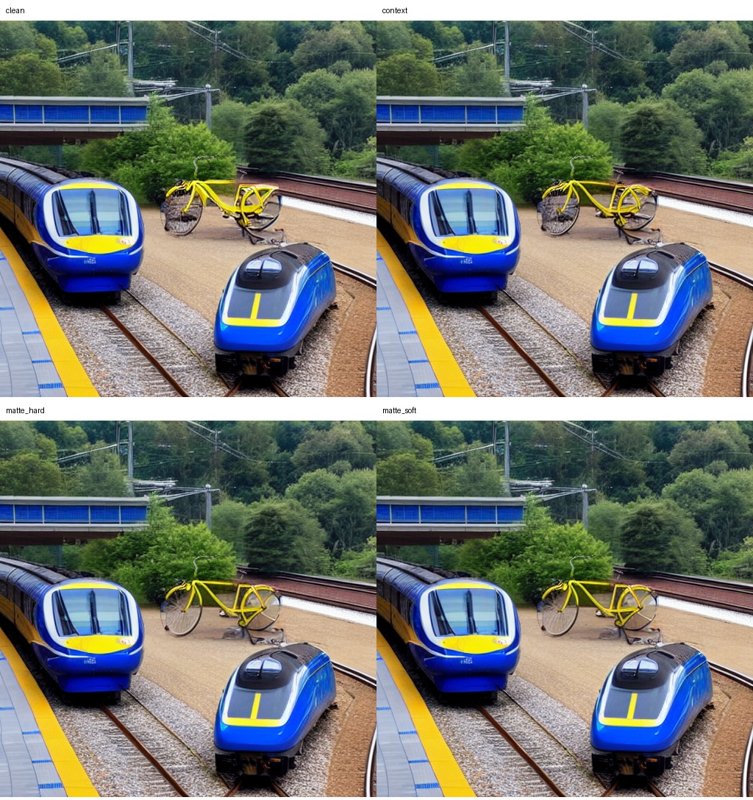
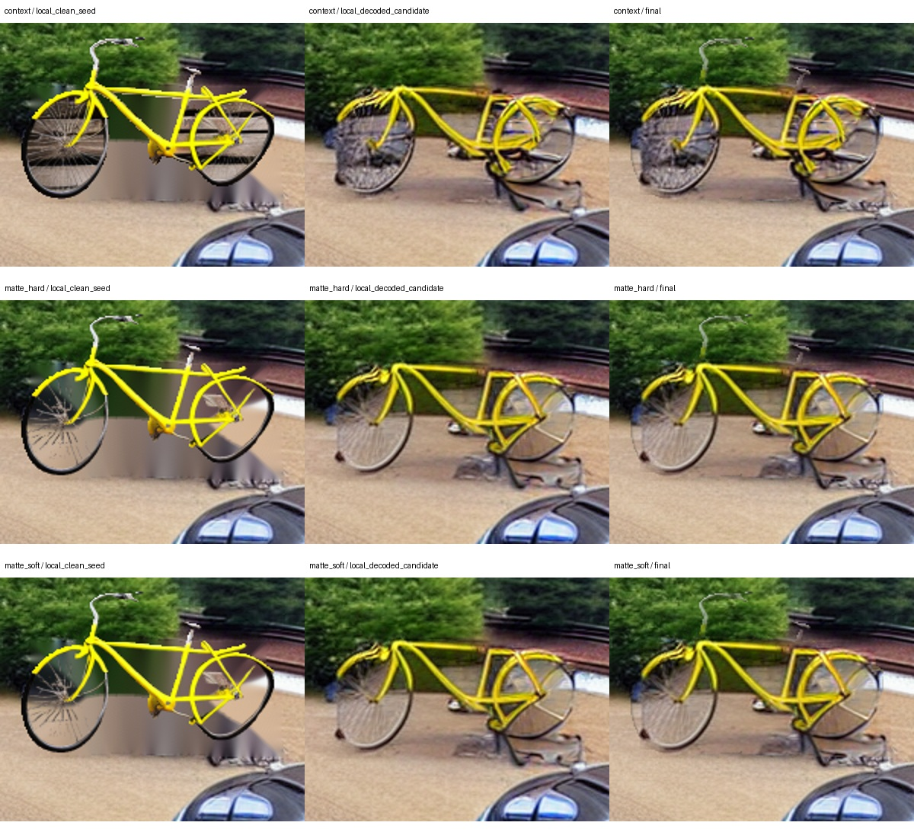
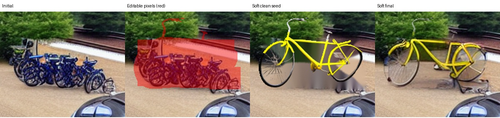

# Foreground screen: cleaner wheel interiors, persistent shape and realism failures

Run `20261103T035056Z_dc40e4b5`, code `1ac6ec9`, NVIDIA L4 22 GB. All **81 exported artifacts** pass manifest SHA-256 checks; four intentionally unexported M2 cache files are listed in the [audit](foreground_run_20261103/audit.json). The four planned outputs are complete. This is one repeatedly inspected development scene and one seed, not held-out or paper evidence.

## Result and decision



Learned extraction produces a visible, limited improvement: much less wooden-board texture is carried into the wheel interiors. This improvement survives scene denoising in both hard and soft variants. Changing the context anchor alone leaves the contaminated wheel discs largely intact. Hard and soft results look very similar; this run does not justify declaring either the quality winner.

The bicycle still has malformed frame/rear-wheel connections, weakened thin structures and detached-looking pieces underneath. It does not look convincingly natural in the scene. This is engineering inspection with known method labels, **not new human scores**. Cleaner extraction does not establish correct bicycle anatomy, sketch shape, placement or broad scene-generation quality.

**Retain learned extraction as a useful experimental component; do not promote this complete repair pipeline as a successful model. Stop the repeated four-arm bicycle sweep.** No new GPU run, larger candidate pool or paper/full escalation is justified by these results. No inference parameters or weights are changed in this results update.

## Measured endpoints

| Variant | Class-count error | Box mIoU | CLIP | Standalone sampling work |
|---|---:|---:|---:|---:|
| Original clean repair | 0 | .73340 | 33.71369 | 280 |
| Context anchor | 0 | .73851 | 33.70676 | 280 |
| Learned hard extraction | 0 | .73300 | 33.42460 | 280 |
| Learned soft extraction | 0 | .73172 | 33.29917 | 280 |

OPR, relation accuracy and joint **box-layout** success are 1 in all arms. These endpoints cannot detect the remaining anatomy/naturalness failures. Relative to the context control, learned hard/soft extraction reduces mIoU by about .00551/.00679 and CLIP by .28217/.40760. The visible extraction gain is not a gain in these automatic metrics; neither type of observation should be substituted for the other. No p-values or confidence intervals are meaningful here.

[Per-image values](foreground_run_20261103/metrics.csv) retain the original exported columns, with the report's reconstructed `standalone_time_s` and audited `sampling_work` appended. Standalone times are 71.12/58.37/72.86/67.29 seconds in table order. These include shared-work reconstruction and unequal cold-start effects; they are not a reliable latency ranking.

The learned foreground forward takes **8.83 seconds on CPU** in this run. The hard arm records 14.42 seconds including setup, while soft reuses its probability and records roughly .003 seconds for that lookup. Soft's reconstructed standalone time charges the reused 8.83-second forward. Total executed diffusion sampling work across the shared run is **460**, versus 280 per standalone arm. Neither measure includes all foreground/detector/VAE work; unchanged diffusion counts do not imply unchanged total compute.

## What the intermediate images establish



1. The learned clean seeds remove most imported wooden boards from the wheels. This confirms the CPU extraction result in the actual Colab path.
2. Thin spokes, tire/frame detail and parts of the handlebar are clearer in the soft seed than in its decoded output. Degradation therefore occurs during the combined VAE/latent-denoising/decode stage, before final compositing. This does **not** isolate the VAE, resolution, ControlNet, anchoring or noise schedule as the sole cause.
3. The Telea-filled background is smeared before denoising. Foreground transparency exposes that imperfect background. A segmentation fix alone cannot make the replacement scene realistic.
4. Some old bicycle fragments remain near the right/bottom edit boundary and the protected front train. Exact preservation of protected pixels is necessary but cannot erase remnants in those pixels. Enlarging the repair region indiscriminately would risk editing the train.



The original SAM `placed_proposal` diagnostic remains unchanged deliberately. For learned variants the actual seed is made from `refined_probability` and the frozen placement; judging only that original SAM diagnostic would incorrectly suggest the new extractor was not used.

## Integrity and reproduction

The CPU audit verifies common initial/proposal pixels, original SAM placement and masks, control sketch, target/extras, M2 key/subset, conditioning, seed and configuration. It reconstructs each clean background and clean seed **pixel for pixel**, including premultiplied resampling for hard/soft. Both learned arms use the same saved source probability, placement and pinned model hash. Every final equals its accepted candidate; every pixel outside the permitted mask, including both requested train rectangles, is unchanged. Work is recomputed from actual and cached model-call counts.

```bash
python tools/audit_foreground_run.py --bundle-root /path/to/merged-foreground-export \
  --out /tmp/foreground-run-audit
```

This reads saved artifacts and runs only CPU image operations. It does not load diffusion/foreground weights or produce new generated scenes. The manifest hash and source commit are retained in `audit.json`.

Validation of this update: both review tests pass, including focused-form round-trip and rejection of mismatched image labels; the actual packet passes Chromium rendering, zoom, JSON download/import, blank/uncertain scores, preservation of previously imported hidden scores, analyzer round-trip and mobile-width checks. Chromium was tested through localhost because this managed browser blocks local-file navigation. All five notebooks validate and regenerate deterministically; their executable cells are unchanged. Synthetic browser-test ratings are kept outside the repository and are not study results.

## Focused user review, without Colab

Download [the review ZIP](reviews/ocsd-foreground-review-20261103.zip), extract it and open `REVIEW.html`. It contains the original sketch, caption and four original PNG outputs, with anonymous A–D labels, zoom and three criteria: count, shape and realism. The page has **12 score fields**; everything else stays unanswered. Detailed Vietnamese instructions are in the ZIP. Click **Tải kết quả JSON** and return `ocsd_review_20261103T035056Z_dc40e4b5.json`. Partial/uncertain answers are allowed.

The page contains no metric ranking, suggested winner or engineering-stage images. The user has already seen related results, so this remains development feedback, not an independent blinded study. No human response is inferred from these figures. The review can prioritize the remaining errors; it is not needed to establish that this is insufficient evidence for a best-model claim.

## Next research direction

Freeze these outputs and stop optimizing this scene's detector pass rate. The next model comparison should test direct instance/scribble conditioning against compositing; the [official InstanceDiffusion/MIGC investigation](RESEARCH_20261102.md) remains relevant. Integration and environment parity must precede GPU execution; neither baseline has been run here. A candidate must then be frozen and tested on **new** scenes/seeds selected by a fixed rule, including thin structures and solid-object controls, with independent shape/realism assessment and all inference cost counted. This experiment is an ablation of pretrained components, not evidence of a new segmentation architecture or SOTA.
