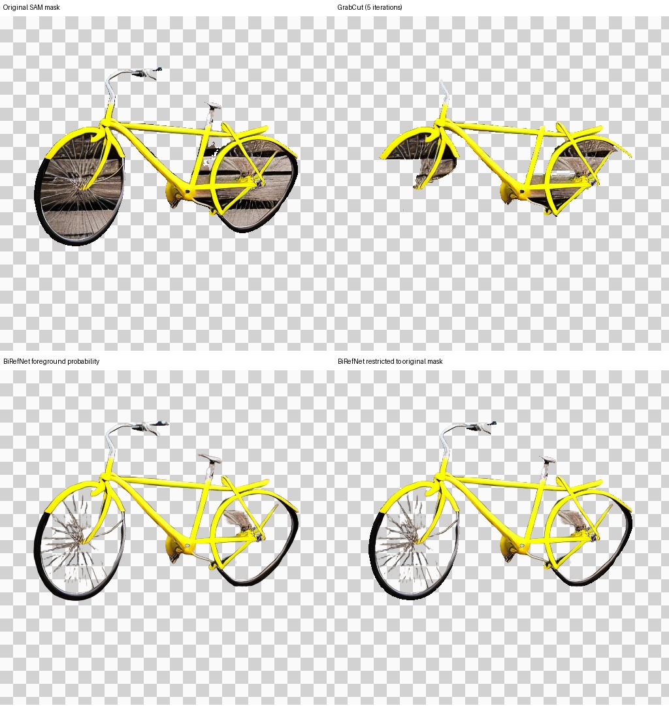

# Foreground extraction and context anchors: completed diagnostic protocol

> Completed: run `20261103T035056Z_dc40e4b5`. [Results and user review](FOREGROUND_20261103_RESULTS.md) favor learned extraction, with count/shape accepted on this scene and naturalness still limited. Do not repeat this sweep or scale it up. The text below preserves the prospective protocol; GPU execution and user review are no longer pending.

## Offline evidence before spending more Colab GPU time

The previous clean-canvas run exposed wooden-board pixels copied into bicycle wheels by the selected SAM mask. A CPU-only audit was run on that saved proposal, without regenerating the scene:



- GrabCut, initialized with the existing mask and five fixed iterations, removes much of the background but also large sections of the tires. Reject this candidate; reduced mask area is not automatically better extraction.
- BiRefNet-general-lite removes most visible wooden-board texture while retaining both wheel rims/tires and many spokes. Some fine structures remain imperfect. This is encouraging engineering inspection on **one** saved image, not a ground-truth alpha-matting score or a scene-generation improvement.
- The learned output is a foreground probability used as an experimental blending weight. It is **not a calibrated physical alpha matte**. Both the raw probability and its intersection with the original SAM support are available in the audit figure.

[Audit provenance](foreground_audit_20261103/audit.json) records source image/mask hashes, model hash, ONNX Runtime version, CPU provider and timing. Probability mass and area fractions are reported only as descriptive diagnostics, not accuracy metrics. The committed audit took about 33 seconds including session loading; timings are machine-specific and not a Colab benchmark. Images were processed locally; only public model weights were downloaded.

Reproduce with:

```bash
python tools/audit_foreground.py --bundle-root /path/to/clean-export \
  --out /tmp/foreground-audit --model-cache /path/to/model-cache
```

The tool checks the export manifest, runs the fixed GrabCut comparator and the learned model, and writes the figure/probability/provenance. It does not generate new scene images or rate human quality.

## Why the integration needs more than replacing a mask

The existing `paste_back` casts masks to uint8 and uses nearest-neighbor sampling. Passing a float probability into that path would discard nearly every fractional pixel. In addition, its resized RGB can mix foreground with source background at boundaries. The new path resizes premultiplied color and opacity together, then divides to recover foreground color. This keeps dark tires and fractional coverage without baking source background into edge pixels.

Placement is frozen from the **original** M2/SAM placement search. The learned mask does not change scale or translation, and its placed support is clipped to the original support. The edit mask and protected objects remain identical. M2 results are not mutated in the shared cache.

A second concern is the old foreground latent anchor: it encodes a white canvas around the cutout, so newly transparent holes can still see white/source background through latent neighborhoods. A context-anchor control instead anchors the clean object-on-scene canvas already used to initialize denoising. This is separated from learned extraction with its own arm.

## Four arms, one known development scene

Default `RUN_ALL.ipynb` tier: `foreground_screen`, scene `qd_3_simple_000`, seed 0.

| Method | Extraction/placement | Foreground latent anchor |
|---|---|---|
| `instance_repair_count_clean` | original SAM and original placement | original white foreground canvas |
| `instance_repair_count_context` | original SAM and original placement | clean scene canvas |
| `instance_repair_count_matte_hard` | learned probability thresholded at .5, premultiplied area resize, frozen placement | clean scene canvas |
| `instance_repair_count_matte_soft` | continuous learned probability, premultiplied area resize, frozen placement | clean scene canvas |

All four use clean initialization/final blending and the same original image, M2 proposal, mask, focused conditioning, seeds, diffusion schedule and acceptance rule. Refined hard versus refined soft isolates source thresholding; context versus refined hard tests the extraction/resampling bundle, not the individual contribution of every resampling operation. Area resampling can give fractional boundary coverage even in the source-thresholded arm.

All changes apply only to count replacement. Missing-object routes keep prior focused behavior. Invalid model hashes cause a visible failure instead of silently substituting another model. An empty visible refined foreground falls back to the initial image. No detector thresholds, extra attempts or new seed search are introduced.

## Compute, dependencies and provenance

Each arm remains capped at 280 standalone batch-weighted diffusion sampling units; the shared run uses 460 units if all four reach repair. **This does not include learned extraction**, detector/encoder work, VAE operations or I/O. BiRefNet runs on CPU with four threads. Hard/soft arms reuse the same probability in memory; logs record actual versus standalone forward cost and the reused duration. The first learned arm also pays session loading/download costs. These one-scene times are not a fair throughput benchmark.

The context anchor reuses the clean initialization latent instead of encoding a separate white foreground, saving that one VAE encode. `repair_canvas` records this distinction. The total cost must include the additional foreground model; unchanged diffusion counts do not mean unchanged end-to-end compute.

- Model: BiRefNet-general-lite (pretrained, external contribution), ONNX conversion distributed by rembg.
- Source architecture: [BiRefNet](https://github.com/ZhengPeng7/BiRefNet), MIT license advertised by upstream.
- ONNX/preprocessing reference: [rembg session](https://github.com/danielgatis/rembg/blob/e2c2e3f72701357b9bb3f2be32a4330d74ce8f47/rembg/sessions/birefnet_general_lite.py), and its general/base session implementations.
- Weight download: `https://github.com/danielgatis/rembg/releases/download/v0.0.0/BiRefNet-general-bb_swin_v1_tiny-epoch_232.onnx` (224,005,088 bytes).
- Required SHA-256: `5600024376f572a557870a5eb0afb1e5961636bef4e1e22132025467d0f03333`. It is verified before constructing the CPU session. Upstream MD5 was also checked on the initial download.
- ONNX Runtime is pinned to `1.23.2`; version/provider/hash are logged in each learned arm. No `trust_remote_code` or remote inference API is used.

This is an integration/ablation of existing pretrained components, not a novel segmentation architecture. It does not yet establish novelty or superiority for the OCSD paper.

## Validation and stopping rule

Tests cover checksum rejection, retained fractional coverage, no source-color bleed under downsampling, identical placement/masks/M2/sampling work, preserved outside pixels, unchanged context-control seed, resume and four-image reporting. Real learned CPU inference on the uploaded proposal was also executed; integration tests use tiny diffusion and a deterministic substitute probability map to test wiring without downloading weights during unit tests.

All 51 CPU tests passed (4 new foreground tests plus 47 regressions); five notebooks validate and regenerate deterministically. No new pretrained scene diffusion has run here. This is the remaining validation dependency: a Colab GPU run is needed to determine whether the cleaner cutout survives denoising and improves visible bicycle structure. Passing count/box metrics alone is insufficient. If this bundle fails, do not keep tuning this one scene; prioritize direct instance/scribble-conditioned baselines and new validation data. No paper/full escalation, p-values or confidence intervals on this selected failure.

## Reproduction steps (not a request for another run)

Open the current GitHub `RUN_ALL.ipynb` in a fresh GPU runtime. Keep `TIER="foreground_screen"`, `RUN_ID=""`, then Run all. There are four final images plus diagnostics. The first learned arm downloads about 224 MB of public weights and processes the selected proposal on CPU.

Export the new run with `03_export_screen_review.ipynb` on CPU and send the metrics/image ZIPs. No change to the user's normal export workflow is required. The resulting review should inspect wheel holes, tires/spokes, frame geometry, remnants, scene realism and preserved trains, with original sketch and proposal available side by side. Do not require the user to calculate metrics.
