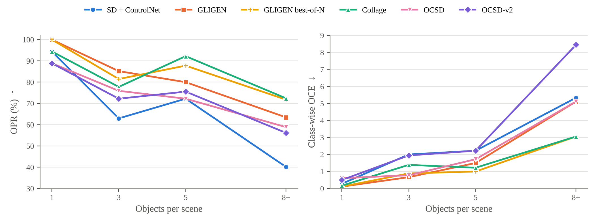
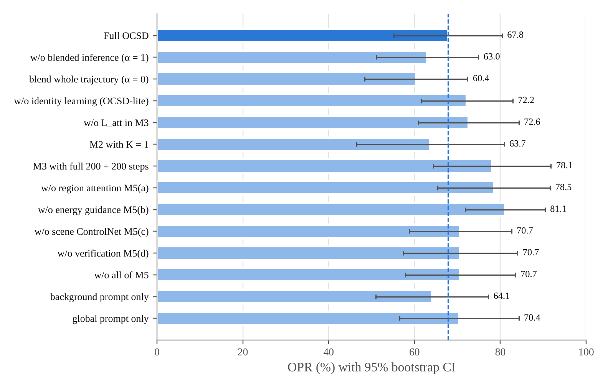
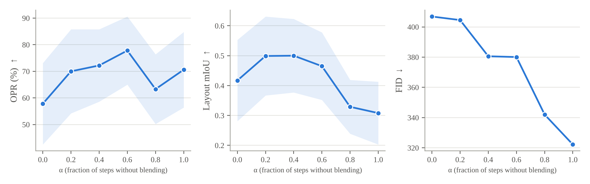

::: {custom-style="Author"}
Le Hoang Bao, Thai Ba Cuong, Nguyen Thanh Chuyen
:::

::: {custom-style="Affiliation"}
Faculty of Information Technology, Industrial University of Ho Chi Minh City, Vietnam
:::

::: {custom-style="Note"}
**Manuscript status (5 November 2026).** The proposed model is OCSD v3 (Section 3.9), evaluated in Section 6 on 18-scene held-out sets under protocols locked before generation (held-out v3: run 20261105T015848Z_8ed9c617, code 9ded82b, results fe0d5eb). A confirmation of OCSD v3 on the full benchmark is pending. Section 5 reports the earlier controlled study of the original OCSD (run of 4 October 2026, code e590c1a), kept unchanged. All tables are generated from the runs' result files.
:::

::: {custom-style="AbstractTitle"}
Abstract
:::

::: {custom-style="Abstract"}
Sketch-and-text conditioned diffusion models such as ControlNet produce convincing images from a single object sketch, but they lose, miscount and misplace objects as soon as a freehand scene sketch contains several of them. We study this *object-consistency* problem with a controlled protocol and report what does and does not fix it. We build two benchmarks, QuickDraw-Scenes (real freehand object sketches arranged into 1- to 10-object scenes at three abstraction levels) and COCO-Sketch (real photographs), and score object preservation (OPR), class-wise count error, layout IoU and relation accuracy with an open-set detector that no method uses internally, with a detector ceiling, robustness checks, compute-matched controls, baseline tuning on a held-out split and Holm-corrected paired tests. A first study of fourteen methods on Stable Diffusion 1.5 shows that our original two-branch method, OCSD, does not beat tuned baselines, and that its attention-control components and per-scene identity learning do not help; generating each object separately and composing it is what helps. A blind review of a later held-out study then showed that methods which place and count objects well still ignore the drawn *shape and pose*. Our final model, OCSD v3, therefore parses the sketch into one sketch per object, turns each object's open strokes into a filled silhouette with a deterministic parser, and gives the silhouettes, boxes and phrases to an existing instance-conditioned generator (InstanceDiffusion), releasing the silhouettes after the layout steps and finishing with the SDXL refiner. On 18 new held-out scenes, under protocols locked before any image was generated, OCSD v3 improves layout IoU over the original OCSD by 0.195 ($p_{Holm}=0.023$), with OPR +0.128 as a trend ($p_{Holm}=0.070$), and is rated far more natural (1.42 vs. 0.36 on a 0–2 scale). On the same generator, the silhouette parser makes objects follow the sketched outline and facing direction better than boxes (facing accuracy 1.00 vs. 0.43 in a dedicated test, $p_{Holm}=0.0001$). OCSD v3 matches Collage and fits the sketch better than GLIGEN, but it does not solve counting in scenes with eight or more objects, and we make no state-of-the-art claim; a confirmation on the full benchmark is pending. We release the benchmarks, code, locked protocols and all per-image results.
:::

**Keywords:** diffusion models, sketch-to-image, scene generation, object consistency, controllable generation, evaluation protocol, negative results, sketch silhouettes, instance conditioning.

# 1. Introduction

Text-to-image diffusion models [@rombach2022ldm; @saharia2022imagen; @ramesh2022dalle2] have made photorealistic synthesis accessible, and spatial adapters such as ControlNet [@zhang2023controlnet] and T2I-Adapter [@mou2024t2i] let a user add a sketch to control shape and layout. For a single object this works well. For a *scene* sketch, which a non-expert draws as several rough objects on one canvas, it frequently does not. The control network treats the whole sketch as one geometric map: it knows *where* there are strokes, but not *which strokes belong to which object*, and binding each region to a phrase of the prompt is left to cross-attention. The result is a familiar set of failures: objects disappear (especially small or abstract ones), duplicates merge or multiply, attributes leak between objects, and objects drift away from where they were drawn. Recent analysis shows that scene complexity, not data imbalance, is the main driver of these multi-object failures, and that counting and spatial relations are the least robust abilities [@jeong2026multiobj].

We call the requirement that the generated image contain *the right objects, in the right number, at the right place and shape, in the right relations* **object consistency**. The closest prior work, Zhang et al. [@zhang2025sketchscene], splits generation into an object-level stage (generate each object from its own sketch, learn an identity embedding with a masked loss) and a scene-level stage (blend object and background latents early, then denoise freely with identity tokens). We started from that design and extended it into OCSD, adding candidate selection, attention separation and an object-aware conditioning module for the free-denoising phase. A first comparison suggested that OCSD preserved the most objects. When we tuned one knob per baseline on the same held-out split and added compute-matched controls, that conclusion did not survive (Section 5). A later held-out study with blind review exposed a second gap: methods that place and count objects well still ignore how each object was drawn, its outline and the direction it faces (Section 6.3). Our final model, OCSD v3, addresses both: it keeps OCSD's object-level parsing, adds a sketch-silhouette parser, and hands generation to an existing instance-conditioned model.

This paper makes four contributions:

1. **An evaluation protocol for object consistency** (Sections 4 and 6.1–6.2). Two automatically built benchmarks with controlled object count and sketch abstraction; detection metrics from an evaluator that no method uses internally; a detector ceiling; robustness to the evaluator; compute-matched best-of-*N* controls; baseline tuning on a held-out split with the same rule as the proposed method; paired tests with Holm correction; and, for the final studies, scenes, arms and decision rules locked in the repository before any image was generated, with sketch-fidelity metrics for outline and facing direction.
2. **OCSD v3** (Section 3.9). An instance parser and a deterministic sketch-silhouette parser that turn a freehand scene sketch into per-object masks, used to condition InstanceDiffusion [@wang2024instancediffusion], an external generator that we use unchanged, with the silhouettes released after the layout steps and an SDXL refiner [@podell2024sdxl] pass. Our contribution is the parsing and the release-and-refine schedule, not the generator.
3. **Held-out evidence** (Section 6). On new scenes, OCSD v3 improves layout over the original OCSD and is far more natural; on the same generator, the silhouette parser makes objects follow the sketch's outline and facing direction better than boxes.
4. **Honest negative results** (Sections 5 and 6). With tuned baselines, the original OCSD scene stage, its region-attention and energy-guidance components and per-scene identity learning do not help; detector metrics overrate every method on shape and pose; and no method, OCSD v3 included, counts reliably in scenes with eight or more objects.

# 2. Related Work

**Sketch-to-image generation.** Early work used conditional GANs: pix2pix [@isola2017pix2pix] for pixel-aligned edges and SketchyGAN [@chen2018sketchygan] on the Sketchy database [@sangkloy2016sketchy]. With diffusion models, Voynov et al. [@voynov2023sketch] guide sampling with a latent edge predictor, and Koley et al. [@koley2023picture; @koley2024sketch] argue that abstract sketches should be interpreted semantically rather than traced pixel by pixel. ControlNet [@zhang2023controlnet], T2I-Adapter [@mou2024t2i] and Uni-ControlNet [@zhao2023unicontrolnet] add spatial conditions to a frozen text-to-image model and are the de facto baselines for sketch control.

**Scene-level sketches.** Sketch2Photo [@chen2009sketch2photo] composed retrieved photographs; SketchyCOCO [@gao2020sketchycoco] separated foreground and background with EdgeGAN but covers only 14 foreground classes; FS-COCO [@chowdhury2022fscoco] and SketchyScene [@zou2018sketchyscene] provide freehand scene sketches. Unsupervised and text-guided scene sketch-to-photo methods [@wang2022unsupscene; @maungmaung2023textscene] normalise sketches and photos to an edge domain, Cheng et al. [@cheng2024multiobj] address multi-object interference with per-object control, FineControlNet [@choi2023finecontrolnet] injects region-wise text alongside spatial control, and SketchingReality [@bourouis2026sketchingreality] trains a sketch-semantics modulation network with attention supervision. Zhang et al. [@zhang2025sketchscene] is our starting point and is described in Section 1.

**Layout and multi-object control.** For text prompts, Attend-and-Excite [@chefer2023attend] maximises the attention of neglected tokens, Structured Diffusion [@feng2023structured] and SynGen [@rassin2023linguistic] bind attributes through syntax, and Composable Diffusion [@liu2022composable] adds score functions. With boxes, GLIGEN [@li2023gligen] trains gated self-attention layers for grounding, while BoxDiff [@xie2023boxdiff], Layout Guidance [@chen2024trainingfreelayout] and Attention Refocusing [@phung2024refocus] steer attention maps with energy functions at inference; DenseDiffusion [@kim2023dense] modulates attention scores with region masks and MultiDiffusion [@bartal2023multidiffusion] fuses region-wise diffusion paths. Object-level semantic alignment has also been shown to improve multi-object fidelity [@liu2026objalign]. InstanceDiffusion [@wang2024instancediffusion] generalises box grounding to per-instance points, scribbles, boxes or masks and samples each instance separately before merging. These methods take boxes or masks, not the open, abstract strokes of a freehand sketch; OCSD v3 (Section 3.9) bridges that gap.

**Identity and consistency.** Textual Inversion [@gal2023textual], DreamBooth [@ruiz2023dreambooth], LoRA [@hu2022lora] and IP-Adapter [@ye2023ipadapter] personalise a model to a concept; Break-A-Scene [@avrahami2023breakascene] extracts several concepts from one image with a masked loss and a cross-attention loss; MasaCtrl, ConsiStory and StoryDiffusion [@cao2023masactrl; @tewel2024consistory; @zhou2024storydiffusion] share self-attention to keep subjects consistent across images. OCSD borrows the masked loss and attention supervision for per-scene identity tokens, and combines them with sketch-derived regions.

# 3. Method

## 3.1 Problem formulation

The input is a scene sketch $\mathcal{S}$ of size $H\times W$ ($512\times512$) containing $N$ foreground objects and a prompt $\mathcal{P}$ that contains object phrases $\{p_1,\ldots,p_N\}$ (class and attributes, e.g. "two white sheep") and a background phrase $p_{bg}$. Each object carries *object information* $o_i=(c_i,\mathbf{m}_i,\mathbf{b}_i,a_i)$: class, region mask, bounding box and attributes, and the objects are linked by spatial relations $\mathcal{R}=\{(i,j,r)\}$ with $r\in\{$left, right, above, below, in front, behind$\}$. An output image $\mathbf{I}$ is *object-consistent* if (R1) every object appears with the right class and attributes, (R2) the per-class count matches the sketch, (R3) each object occupies its sketched region and follows its shape, and (R4) every relation in $\mathcal{R}$ holds. We ask: (Q1) how fast does a sketch-conditioned baseline degrade as object count and sketch abstraction grow; (Q2) does splitting generation into object and scene levels with identity tokens help; and (Q3) does object-aware conditioning reduce the remaining loss, count and relation errors.

## 3.2 Overview

Figure 1 shows the pipeline. M1 parses the sketch and prompt into objects. The object-level branch generates each object (M2) and learns its identity (M3); the scene-level branch composes the scene with blended and customised inference (M4) under object-aware conditioning (M5). All modules share Stable Diffusion 1.5 [@rombach2022ldm] with ControlNet Scribble v1.1, so every baseline in Section 5 can run on the same backbone. Sections 3.3–3.7 describe the original OCSD, Section 3.8 a training-free single-trajectory variant, Section 5.1 a simpler object-first baseline (Collage) built from the same M1 and M2, and Section 3.9 the final model, OCSD v3, which keeps M1 and replaces the scene stage with sketch silhouettes and an instance-conditioned generator.

{width=6.5in}

## 3.3 Object decomposition (M1)

The sketch is binarised, padded to $512\times512$, thinned and re-thickened to about 3 px to match ControlNet Scribble's training distribution. Strokes are grouped into objects from drawing layers when the user draws one object per layer (the interactive mode), from benchmark annotations, or, as a fallback, by connected components after dilation. The mask $\mathbf{m}_i$ is the convex hull of the object's strokes after morphological closing, dilated by 9 px, and $\mathbf{b}_i$ is its bounding box. Relations follow geometric rules on box centres with a margin $\delta=0.05W$; "in front of" is decided by the lower box edge under a ground-plane assumption. Object phrases are matched to sketched objects by class and left-to-right order, and the global prompt is rebuilt as $\mathcal{P}_g=$ "a photo of $\langle o_1\rangle$ $c_1$ and … $\langle o_N\rangle$ $c_N$, $p_{bg}$".

## 3.4 Object-level generation with candidate selection (M2)

Each object sketch is cropped to its box, centred and resized to $512\times512$, and $K$ candidates are generated with ControlNet Scribble and the prompt "a photo of a $p_i$, simple white background". Using the user's full phrase, not only the class name as in [@zhang2025sketchscene], attaches attributes to the right object from the start. Grounded-SAM [@ren2024groundedsam; @liu2024groundingdino; @kirillov2023sam] segments each candidate, and the candidate with the highest normalised score

$$k^*=\arg\max_k\Big[\lambda_1\,\mathrm{CLIP}\big(\mathbf{x}_i^{(k)}\odot\hat{\mathbf{m}}_i^{(k)},p_i\big)+\lambda_2\,\mathrm{IoU}\big(\hat{\mathbf{m}}_i^{(k)},\mathbf{m}_i^{crop}\big)+\lambda_3\,\mathrm{conf}_{det}\Big]$$

is kept ($\lambda_1=\lambda_2=\lambda_3=1$), rewarding correct semantics, faithful shape and a confident detection. M2 and M3 run once per scene with a fixed preparation seed and are reused across generation seeds and ablation variants, so that differences between variants come only from the changed component.

## 3.5 Identity learning (M3)

For each object a new token $\langle o_i\rangle$ is added to the text encoder, initialised from the embedding of $c_i$, and trained on its object image with the masked diffusion loss

$$\mathcal{L}_{id}=\frac{1}{N}\sum_{i=1}^{N}\mathbb{E}_{\boldsymbol{\epsilon},t}\Big[\big\|\big(\boldsymbol{\epsilon}-\boldsymbol{\epsilon}_{\theta,\Delta}(\mathbf{z}_{i,t},t,\text{“a photo of }\langle o_i\rangle\,c_i\text{”})\big)\odot\tilde{\mathbf{m}}_i\big\|_2^2\Big].$$

Training has two stages: embeddings only (learning rate $5\times10^{-3}$), then embeddings ($5\times10^{-5}$) jointly with rank-16 LoRA [@hu2022lora] on the attention projections ($10^{-4}$). To keep tokens of same-class objects apart, we add an attention-separation term computed on random composites of two or three objects (up to six composites per scene, sampled with probability 0.35):

$$\mathcal{L}_{M3}=\mathcal{L}_{id}+\lambda_{att}\,\frac{1}{N}\sum_{i}\big\|\bar{A}_i-\tilde{\mathbf{m}}_i\big\|_2^2,\qquad \lambda_{att}=0.01,$$

where $\bar{A}_i$ is the normalised $16\times16$ cross-attention map of $\langle o_i\rangle$, in the spirit of Break-A-Scene [@avrahami2023breakascene].

## 3.6 Scene composition (M4)

Object images are cut out with their masks, scaled and shifted to maximise IoU with the sketch masks, and pasted far-to-near, giving a foreground image with latent $\mathbf{z}_{fg,0}$ and a union mask $\tilde{\mathbf{m}}$. A background latent $\mathbf{z}_{bg,t}$ is denoised from noise with the prompt "a photo of $p_{bg}$"; its negative prompt lists the foreground classes so that the background does not spawn extra copies of them (applied to both OCSD and our Zhang et al. re-implementation). Denoising then has two phases:

$$\mathbf{z}_t\leftarrow\mathbf{z}_{bg,t}\odot(1-\tilde{\mathbf{m}})+\mathbf{z}_{fg,t}\odot\tilde{\mathbf{m}}\quad (t>\alpha T),\qquad \mathbf{z}_{t-1}=\mathrm{Denoise}_{\theta,\,s\Delta}(\mathbf{z}_t,\mathcal{P}_g,t)\quad(t\le\alpha T).$$

Blending locks the layout while it is formed; customised inference then harmonises lighting and boundaries while the identity tokens keep each object's appearance. At inference the LoRA update is scaled by a strength $s\in(0,1]$. Because $\mathbf{z}_t$ is overwritten at every blending step, only the background branch needs to be denoised during blending; the scene U-Net runs from the last blending step on, which gives identical results with about half the U-Net calls.

## 3.7 Object-aware conditioning (M5)

M5 replaces the plain denoising step of the customised phase with four mechanisms, each aimed at one consistency requirement.

**(a) Region-restricted cross-attention (R1, R3).** Let $\mathcal{T}_i$ index the prompt tokens of object $i$ (its identity token, attributes and class) and $\mathcal{T}_{bg}$ those of the background phrase. A bias is added before the softmax,

$$A=\mathrm{softmax}\Big(\tfrac{QK^\top}{\sqrt d}+B\Big),\quad B_{n,j}=\begin{cases}-\lambda_t & j\in\mathcal{T}_i,\ n\notin\tilde{\mathbf{m}}_i\\ -\lambda_t & j\in\mathcal{T}_{bg},\ n\in\tilde{\mathbf{m}}\\ 0&\text{otherwise,}\end{cases}\qquad \lambda_t=\lambda_0\big(t/\alpha T\big)^{\gamma},$$

so each object's tokens act only inside its own sketch region and the background tokens only outside the foreground; the restriction relaxes towards the end so boundaries can blend. This resembles DenseDiffusion [@kim2023dense], but uses sketch-shaped masks and identity tokens.

**(b) Attention-energy guidance (R1, R2).** During the first $\tau$ customised steps, the latent is updated by $\mathbf{z}_t\leftarrow\mathbf{z}_t-\eta_t\nabla_{\mathbf{z}_t}E$ with

$$E(\mathbf{z}_t)=\sum_{i=1}^{N}\Big[\big(1-\max_{n\in\tilde{\mathbf{m}}_i}\bar{A}_i[n]\big)+\beta\,\frac{\sum_{n\notin\tilde{\mathbf{m}}_i}\bar{A}_i[n]}{\sum_n\bar{A}_i[n]}\Big].$$

The first term penalises an object that no location attends to strongly (a missing object), as in Attend-and-Excite [@chefer2023attend]; the second penalises attention outside the region (drift or duplication), as in BoxDiff and Layout Guidance [@xie2023boxdiff; @chen2024trainingfreelayout]. Attention maps follow Attend-and-Excite (drop the start token, scale by 100, softmax over text tokens, $3\times3$ Gaussian smoothing), and $\eta_t$ decays linearly from $\eta$ to $\eta/2$. Which tokens the energy acts on is a design choice: steering the identity tokens $\langle o_i\rangle$ turned out to be harmful, and the final configuration, chosen on the tuning split (Section 4.4), steers the object-phrase tokens (attributes and class words) of each object.

**(c) Low-weight scene ControlNet (R3, R4).** The full scene sketch is fed to ControlNet Scribble with conditioning scale $\omega=0.4$ during customised inference, reminding the model of contours and relative placement after hard blending stops, without imposing strokes on the background.

**(d) Post-hoc verification (R1, R2, R4).** Grounding DINO (threshold 0.35) detects every sketched class; detections are matched to sketch boxes by same-class Hungarian matching on IoU. An image passes when every object is matched, every class count is correct and every relation holds. Otherwise OCSD regenerates with a new seed and $\lambda_0\times1.5$, at most $R=2$ times, and returns the image with the highest $\mathrm{OPR}+0.5\,\mathrm{mIoU}+0.25\,\mathrm{RA}-0.25\,\mathrm{OCE}_c/N$. The verifier deliberately differs from the evaluation detector (Section 4.3).

Table 1 lists the hyperparameters. The default column is the full configuration in the code; the experiment column is the reduced setting that fits a Colab Pro budget, with $\alpha$, $s$ and the M5(b) tokens chosen on a held-out tuning split (Section 4.4).

::: {custom-style="TableCaption"}
**Table 1.** OCSD hyperparameters: code default and the setting used in all experiments.
:::

| Symbol | Meaning | Default | Experiments |
|:--|:--|:--:|:--:|
| $T$, $w$ | DDIM steps, CFG scale | 50, 7.5 | 30, 7.5 |
| $K$ | candidates per object (M2), denoising steps | 4, 30 | 2, 20 |
| $S_1$, $S_2$ | embedding / joint steps (M3), LoRA rank | 200 / 200, 16 | 100 / 100, 16 |
| $\alpha$, $s$ | blending switch point, LoRA strength (M4) | 0.5, 1.0 | 0.1, 0.5 (tuned) |
| $\lambda_0$, $\gamma$ | region-attention strength and decay (M5a) | 8, 1 | 8, 1 |
| $\beta$, $\eta$, $\tau$ | energy guidance (M5b), steered tokens | 1, 20, 10 steps, identity | 1, 20, 10 steps, phrase (tuned) |
| $\omega$ | scene ControlNet scale (M5c) | 0.4 | 0.4 |
| $R$ | maximum regenerations (M5d) | 2 | 2 |

## 3.8 OCSD-v2: a single training-free trajectory

The ablation of the first run suggested that OCSD's separate background branch and per-scene training might be the weak points, so we also evaluate a training-free variant. OCSD-v2 keeps M1 and M2 but drops M3, and replaces the two-branch sampler of M4 with one joint trajectory: the composed foreground is re-imposed on the scene latent inside the object masks for $t>\alpha T$, and the four M5 mechanisms act from the first step rather than only in the free phase. Energy guidance is averaged over objects instead of summed, very small objects get a minimum mask size in the attention grid, and on COCO the class words of the caption are restricted to the masks of their class. Instead of regenerating the whole image when the M5(d) check fails, OCSD-v2 repairs only the regions of the missing objects. Its $\alpha$ was tuned on the held-out split ($\alpha=0.4$; Section 4.4).

## 3.9 OCSD v3: sketch silhouettes for an instance-conditioned generator

Sections 5 and 6.3 show two weaknesses of the pipeline above: its scene stage loses objects that a naive composition keeps, and like every method we tested it rarely reproduces the drawn pose. OCSD v3 keeps the object-level parsing of OCSD and replaces the scene stage with an existing instance-conditioned generator, InstanceDiffusion [@wang2024instancediffusion], which accepts, for every object, a phrase plus a location given as a box, points, a scribble or a mask, and samples each instance separately before merging them. A box fixes where an object goes but not its outline or the direction it faces, and a freehand QuickDraw drawing cannot be used as a mask directly, because its strokes are open lines: a car body is an arc, a tree a U, an umbrella a dome with a hook. OCSD v3 runs four steps, with no per-scene training:

1. **Instance parsing (M1).** The scene sketch is split into one sketch per object (Section 3.3), each with its phrase and the box of its ink.
2. **Sketch-silhouette parsing.** Each object's ink is skeletonised and its stroke ends (skeleton pixels with exactly one neighbour) are found. Each pair of *mutually* nearest ends at most one ink-box diagonal apart is joined by a straight 3-px line; small gaps are then closed with a disk of radius 0.03 times the ink-box diagonal (at least 2 px), enclosed holes are filled, and the original ink is always added back. The mask is passed both as a mask and as a 256-point polygon (half boundary, half interior points, sampled deterministically as in the official code). It is parsed from the user's sketch only, never from ground-truth masks.
3. **Instance-conditioned generation.** InstanceDiffusion's official sampler, used unchanged: 50 PLMS steps, multi-instance sampling for the first 36% of the steps, grounding fraction $\alpha=0.8$, CFG 7.5, with boxes, centre points, phrases and silhouettes, and the official mean merge of instance latents.
4. **Release and refine.** The silhouettes are released after the multi-instance (layout) phase, so the remaining steps can blend objects into the scene, and the image is refined with the SDXL refiner [@podell2024sdxl] (strength 0.35, 20 steps).

The thresholds of step 2 and the choices of step 4 were fixed on development scenes before any held-out output (Section 6.1); OCSD v3 has never been tuned on an evaluation scene. Figure 6 shows the parser on development drawings.

{width=6.0in}

**OCSD soft-matte.** Between the October and November studies the original pipeline was also extended with count-aware repair of missing instances and a learned soft foreground matte for pasting objects. This route, the strongest variant of the original OCSD in development reviews, is a baseline in held-out v1 and v2.

# 4. Evaluation Protocol

## 4.1 Benchmarks

Public scene-sketch datasets [@gao2020sketchycoco; @chowdhury2022fscoco] do not let us vary object count and sketch abstraction independently, and do not provide per-object sketches with phrases. We therefore build two complementary benchmarks, both generated automatically by the released code.

**QuickDraw-Scenes.** Real freehand object sketches from Quick, Draw! [@jongejan2016quickdraw] in 28 classes shared with COCO are arranged on a $512\times512$ canvas with a perspective layout in 12 settings (e.g. "in a green meadow", "on a city street"), so class, mask, box and relations of every object are known exactly. Scenes form a $4\times3$ grid: 1, 3, 5 or 8 to 10 objects, times three abstraction levels. Sketch detail is measured as points plus ten times strokes and split into per-class terciles: *simple* uses the most detailed tercile, recognised sketches and no overlap; *medium* the middle tercile with box IoU up to 0.15; *complex* the most abstract tercile, IoU up to 0.30, Gaussian stroke jitter ($\sigma=2.5$ px) and thinner strokes. To test counting, 40% of objects duplicate an existing class and phrase ("three white sheep"), and the caption states the counts so that text-only methods also know them.

**COCO-Sketch.** COCO val2017 [@lin2014coco] images with 1 to 8 salient objects (each at least 1.5% of the image and not cut by the border), balanced over 1, 2–3, 4–5 and 6–8 objects, cropped to $512\times512$. Sketches are PiDiNet [@su2021pidinet] scribbles, split per object by the ground-truth masks; captions are the human COCO captions, which every method receives (for OCSD they are appended to $\mathcal{P}_g$). Real images allow FID/KID and a detector ceiling.

## 4.2 Protocol

The evaluation uses 72 QuickDraw-Scenes scenes (6 per cell). Methods that need per-scene identity learning (OCSD, Zhang et al.) run on a stratified 36-scene subset (3 per cell) with two seeds; all other methods run on all 72 scenes with seed 0 and additionally with seed 1 on the 36-scene subset, so the main comparison has every method on the same scenes and seeds. On COCO-Sketch, training-free methods run on 32 scenes and all methods on a common 16-scene subset (one seed). The OCSD ablation uses 18 identity-learning scenes with 3 and 5 objects (seed 0 for every row), the OCSD-v2 ablation 18 QuickDraw and 32 COCO scenes, and the $\alpha$ study 12 scenes. Every method uses SD 1.5, DDIM with 30 steps, CFG 7.5, the same negative prompt and the same seeds. Experiments ran on one NVIDIA A100 40 GB in Google Colab.

## 4.3 Metrics

Detection-based metrics use **OWLv2** [@minderer2023owlv2] (threshold 0.30), queried with the sketched class names; detections are matched to sketch boxes by same-class Hungarian matching with IoU at least 0.1. OWLv2 is deliberately different from Grounding DINO, which OCSD, Collage and the best-of-*N* baselines use as their internal check, so no method is rewarded for optimising against its own judge.

- **Object preservation rate** $\mathrm{OPR}=N_{preserved}/N_{input}$ (R1).
- **Class-wise object count error** $\mathrm{OCE}_c=\sum_c\left|N_{gen,c}-N_{input,c}\right|$, which, unlike the total count error, cannot cancel a missing object of one class against an extra object of another; and **count accuracy**, the share of images with $\mathrm{OCE}_c=0$ (R2).
- **Layout mIoU** between matched detections and sketch boxes, unmatched objects counting as zero (R3), and **relation accuracy (RA)**, the share of sketch relations preserved (R4).
- **CLIP score** [@hessel2021clipscore] with ViT-L/14 [@radford2021clip] for the whole image, and **object CLIP**, computed on crops at the *sketch* boxes against "a photo of a $p_i$", which checks attribute binding independently of the detector.
- **ID-Sim**, the DINOv2 [@oquab2024dinov2] cosine similarity between each object region in the scene and its M2 object image (methods that use M2 only), and **FID/KID** [@heusel2017fid; @binkowski2018kid] against 2,000 COCO val2017 crops, computed for every method on the same 72 QuickDraw-Scenes and 16 COCO-Sketch images.

**Detector ceiling and robustness.** On COCO-Sketch we score the real photographs themselves: they certainly contain all objects, so their OPR bounds what OWLv2 lets any method reach. To check that conclusions do not depend on the evaluator, OPR is also computed at IoU 0.5, with OWLv2 queried with all classes at once (competing queries, so a cow cannot be counted as a horse), and with a closed-set COCO-trained DETR; we report Kendall's τ between rankings.

**Fair sampling budget.** OCSD may generate up to three times. **ControlNet best-of-3** regenerates the baseline with the *same* Grounding DINO check and selection score, and the **best-of-*N*** variants of ControlNet and GLIGEN sample up to $N=8$ times with the same check, stopping at the first image that passes; Table 9 reports their measured cost.

**Statistics.** Metrics are averaged over seeds per scene and then over scenes, reported as mean ± half-width of a 95% bootstrap interval (2,000 scene resamples) [@efron1993bootstrap]. Methods are compared by two-sided paired Wilcoxon signed-rank tests on per-scene values [@wilcoxon1945] with Holm correction [@holm1979] within each family of comparisons (one reference method against all others, per metric). The tests for the object-first comparisons in Section 5.3 were added after the run and are labelled as such.

## 4.4 Held-out tuning for every method

All tuning used 16 pilot scenes (12 QuickDraw-Scenes, 4 COCO-Sketch, two seeds) that are **excluded from every evaluation set**, and one rule: maximise OPR + mIoU + RA subject to global CLIP within one point of the reference setting.

*OCSD* was tuned in three phases. Phase 1 chose $\alpha=0.1$ and LoRA strength $s=0.5$ from $\alpha\in\{0,0.1,0.2,0.3,0.5\}\times s\in\{0.5,1.0\}$ (score 1.562 vs. 1.294 for the default $\alpha=0.5$, $s=1$). Phase 2 compared five energy-guidance options and chose phrase tokens with $\eta=20$ (1.754) over no guidance (1.704) and the original identity-token setting (1.414). Phase 3 crossed M5(a)/M5(b) on/off with $\alpha\in\{0.1,\ldots,0.6\}$ and kept both components with $\alpha=0.1$ (1.774), just ahead of both at $\alpha=0.3$ (1.765) and region attention only (1.762). *OCSD-v2* was tuned over $\alpha\in\{0.2,0.4,0.6\}$ and chose $\alpha=0.4$ (1.771).

*Each baseline* had one knob tuned with the same rule: ControlNet scale (1.0 kept), T2I-Adapter scale (0.8), GLIGEN's grounding weight $\beta$ (1.0, up from 0.3: OPR 75.2% vs. 66.2% on the tuning split), $\lambda_0$ of the region-attention baseline (12), $\eta$ of the energy baseline (10), the SDEdit strength of Collage (0.2) and $\alpha$ of Zhang et al. (0.1, down from the published 0.5). Variants with best-of-3 or best-of-*N* inherit their base method's value. In an earlier version of this study only OCSD was tuned; tuning the baselines changed the conclusions (Section 5.2), which is why we treat it as part of the protocol.

# 5. Controlled Study of the Original OCSD

This section reports the October 2026 study of the original OCSD (Sections 3.3–3.8) against tuned baselines. Its conclusions motivated OCSD v3, which is evaluated in Section 6.

## 5.1 Compared methods

Fourteen methods share the backbone, sampler and seeds. **Sketch-conditioned, single pass:** (1) **SD + ControlNet** Scribble on the whole sketch; (2) **T2I-Adapter** Sketch [@mou2024t2i]; (3) **CN + region attention**, DenseDiffusion-style [@kim2023dense] masking with OCSD's masks and phrases, replacing FineControlNet [@choi2023finecontrolnet], which has no public SD 1.5 code; (4) **CN + attention energy**, BoxDiff/Attend-and-Excite-style [@xie2023boxdiff; @chefer2023attend]. **Box-grounded:** (5) **GLIGEN** [@li2023gligen] with per-object boxes and phrases (no stroke shape). **Same sampling budget:** (6) **CN best-of-3**, (7) **CN best-of-*N*** and (8) **GLIGEN best-of-*N***. **Object-first:** (9) **Collage**, which pastes OCSD's M2 objects (same placement as M4) onto a ControlNet image of the whole sketch and harmonises the result with SDEdit [@meng2022sdedit] under the caption and the scene ControlNet, with no identity learning and no M5(a)/(b); (10) **Collage best-of-3** with the same check; (11) **Zhang et al.** [@zhang2025sketchscene], re-implemented in the same code base (one candidate, class-name prompt, no attention separation, no M5); (12) **OCSD-lite**, OCSD without identity learning; (13) **OCSD**; (14) **OCSD-v2**.

## 5.2 Main comparison: OCSD does not beat the tuned baselines

::: {custom-style="TableCaption"}
**Table 2.** QuickDraw-Scenes, 36 identity-learning scenes × 2 seeds (mean, with the 95% CI half-width for OPR). FID/KID on the same 72 images per method. Bold: best.
:::

<!-- TABLE:E3_quickdraw -->

**Tuned GLIGEN and the object-first Collage lead.** On QuickDraw-Scenes (Table 2), GLIGEN with a tuned grounding weight preserves 82.2% of sketched objects, Collage 84.2%, and their best-of-*N*/best-of-3 versions 85.3% and 86.2%. OCSD preserves 74.0%, OCSD-lite 72.2% and OCSD-v2 73.2%, about the level of the strongest attention-control baseline (CN + attention energy, 72.9%) and of CN best-of-*N* (71.8%). GLIGEN best-of-*N* has the lowest count error (1.26 vs. 2.06 for OCSD) and the best layout mIoU (0.697 vs. 0.541); Collage best-of-3 has the best relation accuracy (67.0% vs. 50.7%) and identity similarity (0.538 vs. 0.472).

**Significance.** With Holm correction over the 13 comparisons per metric, OCSD is not significantly different from any method on OPR: it trails GLIGEN by 8.2 points (unadjusted $p=0.13$), GLIGEN best-of-*N* by 11.3 ($p=0.020$, $p_{Holm}=0.24$), Collage by 10.2 ($p=0.058$) and Collage best-of-3 by 12.2 ($p=0.021$, $p_{Holm}=0.24$), and leads Zhang et al. by 12.4 ($p=0.010$, $p_{Holm}=0.13$). Its layout mIoU is significantly below GLIGEN's and GLIGEN best-of-*N*'s. OCSD-v2 is significantly below GLIGEN best-of-*N*, Collage and Collage best-of-3 on OPR ($p_{Holm}=0.044$, 0.019 and 0.014) and below OCSD on mIoU (0.406 vs. 0.541, $p_{Holm}<0.01$).

**What changed from our earlier run.** Before the baselines were tuned, OCSD had the highest OPR (75.4% vs. 72.9% for GLIGEN). OCSD itself barely moved (74.0%), but GLIGEN rose from 72.9% to 82.2% when its grounding weight went from 0.3 to 1.0 ($p<0.05$), and our Zhang et al. re-implementation rose from 44.3% to 61.6% when its blending switch moved from the published $\alpha=0.5$ to 0.1. The earlier ranking was an artefact of comparing a tuned method with untuned baselines, a pitfall that the protocol of Section 4.4 is meant to prevent.

**Image quality.** With every method scored on the same images, FID is 254.9 for ControlNet, 249.6 for GLIGEN and 280.2 for OCSD (KID×10³ 28.2, 29.0 and 74.3). OCSD-v2 has the best FID of all methods (242.3, KID 33.2) and the highest global CLIP among sketch-conditioned methods, so its single trajectory fixes most of the cut-out look of OCSD (Figure 2), but at the cost of localisation. Selection by a detector check costs realism: best-of-*N* and best-of-3 raise KID for both GLIGEN (29.0 to 38.6) and Collage (41.8 to 47.2).

{width=6.5in}

## 5.3 Object-first composition is what helps

::: {custom-style="TableCaption"}
**Table 3.** Training-free methods on all 72 QuickDraw-Scenes scenes (every available seed averaged per scene).
:::

<!-- TABLE:E3all_quickdraw -->

Collage is the simplest way to use separately generated objects: paste them where they were drawn and let a few SDEdit steps harmonise the result. On all 72 scenes (Table 3) it preserves 80.6% of objects against 65.2% for ControlNet (+15.3 points, paired Wilcoxon $p<0.001$, Holm over five planned comparisons; RA +24.9, mIoU +0.100, both $p_{Holm}\le0.001$). Box-grounded GLIGEN gains as much over ControlNet (+16.1 OPR, $p_{Holm}<0.001$), and Collage and GLIGEN are statistically indistinguishable on OPR (−0.8, $p=0.85$) and RA, while GLIGEN places objects more accurately (mIoU +0.069, $p_{Holm}=0.007$). The same pattern holds for their best-of variants. These planned tests were run after the main analysis (script released with the paper).

The comparison with OCSD-lite isolates the scene stage: both use the same M2 objects and placement, but OCSD-lite composes them with a separate background branch, blended latents and M5, whereas Collage pastes them onto a ControlNet image. Collage preserves 9.8 points more objects ($p_{Holm}=0.012$) and 13.3 points more relations ($p_{Holm}=0.025$). The object-level stage (M2: per-object generation and best-of-*K* selection) is therefore the part of our pipeline that works, and the elaborate scene stage loses objects that a naive composition keeps.

## 5.4 Degradation with object count and abstraction

{width=6.5in}

::: {custom-style="TableCaption"}
**Table 4.** OPR (%) by object count and by sketch abstraction, QuickDraw-Scenes 36-scene subset.
:::

<!-- TABLE:E1E2 -->

All methods degrade with object count (Figure 3, Table 4). ControlNet falls from 94.4% OPR on single objects to 40.1% at 8–10 objects, and its count error grows from 0.28 to 5.33. In crowded scenes object-first composition helps most: Collage keeps 72.4% of objects and Collage best-of-3 77.6%, against 63.5% for GLIGEN and 71.8% for GLIGEN best-of-*N*, with count errors of 3.06 and 2.94 (tied with GLIGEN best-of-*N*, 3.06) against 5.11 for GLIGEN. OCSD (58.9%) and OCSD-v2 (56.2%) lose this advantage in their scene stage, and OCSD-v2's count error at 8–10 objects (8.44) shows that its joint trajectory adds extra objects. These 8–10-object figures rest on 9 scenes: one-sided exploratory tests of OCSD against GLIGEN, GLIGEN best-of-*N* and Collage all give $p_{Holm}=1$, and our pre-registered power test on this regime has not been run. In our earlier, untuned comparison OCSD led GLIGEN here by 16.6 points; that result does not hold against tuned GLIGEN.

Across abstraction levels, GLIGEN, which ignores stroke shape, is stable (81.1 / 83.9 / 81.5% for simple / medium / complex), and GLIGEN best-of-*N* is best on complex sketches (89.2%). Methods that read the strokes lose most on complex sketches (OCSD 66.8%, ControlNet 62.3%), because ControlNet has to recognise each object from very rough strokes; Collage loses little (82.9%), plausibly because M2's best-of-*K* selection discards wrong-class objects before composition.

## 5.5 Ablations: what does not help

{width=5.2in}

::: {custom-style="TableCaption"}
**Table 5.** OCSD ablation, 18 scenes. Each row changes one component of full OCSD.
:::

<!-- TABLE:E4_quickdraw -->

With 18 scenes and one seed, no ablation row differs significantly from full OCSD after Holm correction (smallest $p_{Holm}=0.24$), so Table 5 shows directions, not established effects. The directions are nevertheless consistent with Section 5.3. The components that touch the *layout* help: removing blended inference ($\alpha=1$) drops mIoU from 0.494 to 0.318, blending during the whole trajectory ($\alpha=0$) costs 7.4 OPR points, and M2 with a single candidate costs 4.1 points. The components meant to *enforce* consistency in the free phase do not: removing region attention M5(a) (78.5%) or energy guidance M5(b) (81.1%) scores *higher* than full OCSD (67.8%), as does OCSD-lite without identity learning (72.2%). Training identity tokens twice as long (78.1%) also scores higher, so the reduced M3 schedule may be part of the problem, but none of these variants was tested against Collage on the same 18 scenes.

::: {custom-style="TableCaption"}
**Table 6.** OCSD-v2 ablation on 18 QuickDraw-Scenes scenes (seed 0).
:::

<!-- TABLE:E4v2_quickdraw -->

The OCSD-v2 ablation (Table 6) gives the same message from the other side. Without any M5 component OCSD-v2 collapses (50.4% OPR), so on a single trajectory some object-aware control is essential, and region repair beats whole-image regeneration (76.3% vs. 73.0%). But replacing the joint trajectory with OCSD's separate background branch *raises* OPR to 80.7% and mIoU from 0.410 to 0.550, and removing region attention again scores higher (78.9%). On COCO, appending the caption to the prompt lowers OCSD-v2's OPR from 55.4% to 51.9% (32 scenes, $p_{Holm}=0.26$) while raising CLIP by 2.9 points.

## 5.6 The tuning split disagrees with the evaluation split

Phase 3 of the tuning (Section 4.4) explicitly compared OCSD with and without M5(a)/(b) on the 16 held-out scenes and kept both (score 1.774 vs. 1.762 with region attention only and 1.644 or less with energy only); the evaluation scenes then preferred dropping either one. Similarly, OCSD-v2 reached 80.3% OPR on the tuning split and 73.2% on the evaluation scenes. With 16 tuning scenes the selection rule cannot resolve differences of this size, so the attention-control components should be read as *not shown to help*, not as shown to hurt. A larger tuning split is the cheapest fix and is part of our next run.

{width=6.5in}

The blending switch $\alpha$ shows the same trade-off in both runs (Figure 5): layout mIoU is highest for $\alpha\in[0.2,0.4]$ (0.50) and falls once blending ends early (0.308 at $\alpha=1$), OPR peaks at $\alpha=0.6$ (77.8%), and FID improves steadily as the blending phase shortens (406.9 at $\alpha=0$ to 322.2 at $\alpha=1$). Layout fidelity and realism pull $\alpha$ in opposite directions, which is the same tension that separates OCSD (good layout, high FID) from OCSD-v2 (worse layout, best FID).

## 5.7 COCO-Sketch

::: {custom-style="TableCaption"}
**Table 7.** COCO-Sketch, 16 scenes common to all methods (one seed; 95% CI half-widths for OPR are 17–21 points). The real photographs reach OPR 57.7%, $\mathrm{OCE}_c$ 2.28, mIoU 0.485 and RA 33.8% under the same evaluator (detector ceiling).
:::

<!-- TABLE:E3_coco -->

Real COCO scenes are much harder: even the photographs reach only 57.7% OPR under OWLv2, because objects are small and occluded, so every generated result should be read against this ceiling. GLIGEN best-of-*N* (58.7%) reaches it, Collage best-of-3 (56.6%), GLIGEN (53.5%) and Collage (52.5%) come close, and OCSD (46.2%) and OCSD-v2 (50.4%) fall short; ControlNet reaches 35.4%. With 16 scenes the intervals are about ±18 OPR points and no difference involving OCSD survives Holm correction, so COCO results are trends. On the 32 training-free scenes, Collage and GLIGEN are again tied on OPR (57.8% vs. 60.7%, $p=0.61$) and both beat ControlNet (42.7%; $p_{Holm}=0.077$ and 0.011). Appending the human caption to OCSD's prompt raised its CLIP score only from 19.4 to 20.2 and lowered OPR from 53.0% to 46.2% (not significant); OCSD and OCSD-lite remain about 4.5 CLIP points below the single-pass baselines on COCO, which we attribute to PiDiNet scribbles containing background strokes that the object-region constraints fight against.

## 5.8 Robustness to the evaluator

::: {custom-style="TableCaption"}
**Table 8.** OPR (%) under different evaluators: OWLv2 (default), OWLv2 requiring IoU ≥ 0.5, OWLv2 with competing class queries, and a closed-set COCO DETR. QD: QuickDraw-Scenes (36 scenes), COCO: COCO-Sketch (16 scenes).
:::

<!-- TABLE:robustness -->

The method ranking is stable across evaluators (Kendall τ with the OWLv2 ranking 0.87 with competing queries and 0.67 with DETR on QuickDraw-Scenes, 0.84 with DETR on COCO-Sketch), and GLIGEN best-of-*N*, Collage best-of-3, Collage and GLIGEN form the top group under every evaluator. Two differences matter. At IoU ≥ 0.5, OCSD-v2 drops from 73.2% to 43.5%, against 64.8% for OCSD and 83.1% for GLIGEN best-of-*N*: its objects exist but are not where they were drawn. And the closed-set DETR is much more lenient on COCO (95.6% for the real photographs vs. 57.7% for OWLv2), so absolute COCO numbers depend strongly on the evaluator while the ranking does not.

## 5.9 Cost

::: {custom-style="TableCaption"}
**Table 9.** Average time per image on an A100 (s), per-scene preparation for the object stage (M2) and identity learning (M3), and generations per image.
:::

<!-- TABLE:runtime -->

ControlNet and GLIGEN take about 2 s per image. Collage takes 3.0 s per image plus 12.3 s of per-scene object generation (M2) that is reused across seeds and prompt edits, which makes it the cheapest method in the top group. OCSD takes 4.9 s per image plus 12.4 s for M2 and 35.6 s for M3; OCSD-v2 avoids M3 but needs 6.9 s per image. The best-of-*N* baselines are the most expensive per image (7.5 s for GLIGEN, 11.4 s for ControlNet, with 3.7 and 5.0 generations on average).

# 6. Held-out Evaluation of OCSD v3

## 6.1 A staged, locked protocol

The results of Section 5 come from one large run whose evaluation scenes we had seen during development. For OCSD v3 we used a stricter procedure. Each stage had its own scene set, arms, decision rule and analysis plan, committed to the repository before any image of that stage was generated: a development study of InstanceDiffusion input variants (8 scenes × 2 seeds); **held-out v1**, InstanceDiffusion with boxes against ControlNet and OCSD soft-matte; a development study of silhouettes; **held-out v2**, silhouettes against boxes; a development study of the release-and-refine schedule; and **held-out v3**, the complete OCSD v3 against the original OCSD and the strongest baselines of Section 5. Each held-out set contains 18 new QuickDraw-Scenes scenes (two per cell of 3, 5 or 8–10 objects × three abstraction levels) with seeds 0 and 1, built with a new generator seed; held-out v2 and v3 share no QuickDraw drawing with any earlier set. No tuning, reranking, extra seeds or reruns were allowed on held-out scenes, and failed images had to be reported rather than replaced (none failed). The unit of analysis is the scene (mean over the two seeds); primary tests are exact two-sided sign tests over scenes with Holm correction, and other differences are reported with paired bootstrap intervals. All held-out runs used an NVIDIA L4; the SD 1.5 arms used the settings of Section 4 (held-out v3: the paper-tier configuration with the frozen tuning of Section 4.4; held-out v1 and v2: a reduced budget).

Two development results are negative findings worth recording. A region-aware merge of instance latents that we designed to remove visible panel seams was picked least often by the blind reviewer and produced all four images rated unnatural, so it was rejected. Releasing the silhouettes after the layout steps made images more natural but lowered facing accuracy on development scenes from 1.00 to 0.79; adding the refiner restored it to 0.93, which is why OCSD v3 keeps both.

## 6.2 Measuring shape and pose

Detector metrics only check that a box of the right class exists. To measure whether a generated object follows the *drawing*, we segment each object with SAM [@kirillov2023sam] inside its target box and compare the outline with the raw sketch ink (not with the parsed silhouette):

- **Sketch chamfer:** the mean distance from the ink to the mask outline, divided by the box diagonal (lower is better; a missing object scores 1).
- **Facing accuracy:** for drawings that are clearly asymmetric (ink-to-mirror distance at least 0.04 of the box diagonal), the share whose ink fits the outline better than its mirror image does. A missing object counts as wrong.

Chamfer partly rewards silhouette-conditioned methods for obeying a mask parsed from the same sketch; the mirror test is less circular, because a box carries no direction and a method can only pass it by reproducing the sketched pose. Thresholds were fixed on development data before SAM was run on any held-out image. Each study also had a review of the 36 image sheets with the arms in random order: structure success means count, colour and shape (including pose) all correct, and naturalness is rated 0–2.

## 6.3 Held-out v1: the detector misses shape and pose

::: {custom-style="TableCaption"}
**Table 10.** Held-out v1, 18 scenes × 2 seeds. Primary endpoint: structure success in a blind review by one human reviewer. Secondary: OWLv2 metrics. The 20-ink-point arm was added after the development study and is exploratory.
:::

<!-- TABLE:heldout1 -->

By the detector, InstanceDiffusion with boxes was far ahead of ControlNet and OCSD soft-matte (OPR 0.81 vs. 0.55 and 0.64, paired intervals excluding zero). The blind review agreed on count and colour (both correct in 26 of 36 box images, 6 ControlNet and 8 OCSD soft-matte images) but not on overall success: only 8, 1 and 3 of 36 images had every object in the right shape, because 28 to 35 images per method failed on shape, mostly pose (a dog drawn standing and facing right generated lying down or facing left). Neither primary test was significant (sign tests 7/1/10 and 6/1/11 wins/losses/ties, $p_{Holm}=0.14$), and adding 20 ink points per object did not fix shape. This study is why we built the silhouette parser, and it is a warning about detector-only evaluation of sketch control.

## 6.4 Held-out v2: silhouettes make objects follow the sketch

::: {custom-style="TableCaption"}
**Table 11.** Held-out v2, 18 new scenes × 2 seeds. Primary endpoint (locked): facing accuracy and sketch chamfer, silhouettes vs. boxes on the same generator, both used for the whole grounded trajectory. Structure success and naturalness (0–2) come from a review by one reviewer, the method's author, from blind sheets, and are secondary.
:::

<!-- TABLE:heldout2 -->

Both primary tests are significant (Table 11). Facing accuracy rises from 0.43 with boxes, chance level since a box carries no direction, to 1.00: objects faced the sketched direction in 64 of 64 asymmetric drawings versus 28 of 64 (14/0/2 scenes, $p_{Holm}=0.0001$). Sketch chamfer falls from 0.060 to 0.041 and is lower in all 18 scenes ($p_{Holm}<0.0001$). Count accuracy is not worse (0.19 vs. 0.14, difference +0.06 [−0.06, 0.19]), and OPR (0.83 vs. 0.72), mIoU (0.75 vs. 0.62) and relation accuracy (0.70 vs. 0.53) improve with intervals excluding zero. The price was naturalness: holding the silhouette for the whole grounded trajectory made 7 of 36 images look cut out (mean 1.28 vs. 1.53, Figure 7 row 5), which motivated the release-and-refine schedule of OCSD v3.

{width=6.5in}

## 6.5 Held-out v3: the complete OCSD v3

::: {custom-style="TableCaption"}
**Table 12.** Held-out v3, 18 new scenes × 2 seeds, scene means. Primary family (locked): OCSD v3 vs. the original OCSD on OPR, mIoU and sketch chamfer, Holm over three. Review columns: structure pass, naturalness (0–2) and "most natural with the right structure" picks from 36 six-panel sheets, reviewed blind by the analyst (the method's author) before unblinding. GLIGEN, Collage and ControlNet use the frozen tuning of Section 4.4. Time per image on an L4.
:::

<!-- TABLE:heldout3 -->

**OCSD v3 improves over the original OCSD.** The locked claim rule required at least one primary test significant after Holm in OCSD v3's favour and none significantly worse. Layout mIoU rises from 0.475 to 0.670 (+0.195 [0.095, 0.297]; better in 15 of 18 scenes, $p=0.0075$, $p_{Holm}=0.023$). OPR rises from 0.664 to 0.792 (+0.128 [0.023, 0.235]; 12/3/3 scenes, $p=0.035$) but does not survive correction ($p_{Holm}=0.070$), so we report it as a trend. Sketch chamfer is slightly lower (0.050 vs. 0.055, $p_{Holm}=0.48$). Relation accuracy improves (+0.23 [0.06, 0.40]); count accuracy (+0.11 [−0.17, 0.36]) and facing accuracy (−0.07 [−0.21, 0.04]) do not differ reliably, and the original OCSD, which pastes objects generated from each sketch, already faces the right way in most cases (0.90). The clearest difference is in the review: OCSD v3 images were rated far more natural (1.42 vs. 0.36; more natural in 16 scenes, less natural in none, $p<0.001$, uncorrected), because the cut-out look of the original pipeline is gone. Structure pass is 12 vs. 9 of 36 (not significant).

**Against the strongest baselines** (secondary family, Holm over six tests), OCSD v3 fits the sketch better than GLIGEN (chamfer 0.050 vs. 0.066; 17/1 scenes, $p_{Holm}=0.0009$; facing +0.33 [0.17, 0.48]); its OPR and mIoU are higher than GLIGEN's (+0.09, +0.10) but not significantly ($p_{Holm}=0.37$ and 0.15). It is level with Collage on OPR, mIoU and chamfer ($p_{Holm}=1.0$ for all three); Collage has a higher CLIP score (−2.45 [−3.98, −0.94] for OCSD v3) but was rated much less natural (0.53; OCSD v3 more natural in 15 of 18 scenes, $p=0.002$, uncorrected). ControlNet follows the strokes most closely (chamfer 0.036, facing 0.98) but keeps the fewest objects in place (OPR 0.60).

**What the parser adds.** Most of the OPR and mIoU gain over the original OCSD comes from the generator: InstanceDiffusion with boxes alone reaches similar OPR (0.77) and mIoU (0.68). On the same generator, the parser adds sketch fidelity, with lower chamfer (−0.008 [−0.012, −0.004]) and higher facing accuracy (+0.28 [0.06, 0.51]) than boxes, at a small cost in naturalness (1.42 vs. 1.61, 2/7 scenes, not significant) and CLIP (−1.07 [−2.30, −0.03]). Releasing the silhouettes after the layout steps also gives up part of the fidelity of held-out v2 (facing 0.83 here vs. 1.00 there, on different scenes), a trade we accepted on development data for naturalness.

**What remains hard.** Scenes with eight or more objects fail for every method: OCSD v3's count accuracy is 0 in that bin (OPR 0.58), and 13 of 36 sheets had no acceptable image, mostly 8+ scenes with missing or extra animals or wrong colours. Count accuracy stays at or below 0.36 for every method, so OCSD v3 does not solve exact counting. It also costs about 27 s per image on an L4, against 7.7 s for the original OCSD and 4.1 s for Collage.

## 6.6 What the held-out studies support

On scenes never used for development, OCSD v3 places objects more accurately than the original OCSD and produces much more natural images, and its silhouette parser makes an instance-conditioned generator follow the drawn outline and facing direction, which boxes cannot do. The evidence has clear limits. Each held-out test has 18 QuickDraw-Scenes scenes and two seeds; a confirmation of OCSD v3 on the full benchmark of Section 5 (72 QuickDraw-Scenes and 32 COCO-Sketch scenes) is pending. The reviews in held-out v2 and v3 were done by the method's author, from blind sheets but with recognisable styles. The generator and the refiner are external; we credit InstanceDiffusion and SDXL for generation quality and claim only the parsing, the schedule and their evaluation. We make no state-of-the-art claim: OCSD v3 is level with Collage and not significantly better than GLIGEN on OPR or mIoU.

# 7. Discussion and Limitations

**Answers to the research questions.** (Q1) Object consistency of sketch-conditioned diffusion degrades sharply with object count: ControlNet keeps 94% of single objects but 40% at 8–10 objects. (Q2) Splitting generation into object and scene levels helps, but the help comes from the object level: generating and selecting each object separately and composing it (Collage) lifts OPR by 15 points over ControlNet and ties box-grounded GLIGEN, and per-object conditioning inside an instance-aware generator (OCSD v3) places objects better than the original OCSD on held-out scenes. (Q3) Attention control in the free denoising phase and per-scene identity learning do not help. What does help is giving the generator each object's *shape*: sketch silhouettes fix the pose failures that boxes and ink points did not.

**What the evidence does not support.** We do not claim that the original OCSD or OCSD-v2 beats the tuned baselines of Section 5, nor that OCSD v3 is state of the art: on held-out v3 it is level with Collage and not significantly better than GLIGEN on OPR or mIoU, and its OPR gain over the original OCSD is a trend. We do not claim better image quality than the instance-conditioned generator with boxes alone, which was rated slightly more natural. Nor do we claim that OCSD v3 counts correctly in crowded scenes.

**Lessons for evaluating controllable generation.** Five parts of the protocol changed our conclusions and we recommend them generally: tuning one knob per baseline on the same held-out split as the proposed method (it moved GLIGEN by 9 points); compute-matched best-of-*N* controls; a stricter-IoU and alternative-detector check (it exposed OCSD-v2's localisation problem); a review with shape and pose criteria, which showed that detector metrics rate images as correct that a person judges wrong; and locking scenes, arms and decision rules before generating, which made each final claim easy to state and to check.

**Limitations.** All results depend on auxiliary models: Grounded-SAM masks in M2, Grounding DINO in the internal checks, OWLv2 in the evaluation and SAM in the sketch-fidelity metrics; the COCO ceiling shows that the evaluation detector alone misses 42% of real objects. QuickDraw-Scenes uses real strokes but synthetic layouts, COCO-Sketch uses PiDiNet scribbles rather than human scene sketches, and the held-out studies use QuickDraw-Scenes only; FS-COCO [@chowdhury2022fscoco] is the natural next test set. Samples are small (36 and 16 scenes in Section 5, 18 scenes per held-out study), and OCSD v3 has not yet been run on the full benchmark. The tuning split (16 scenes) is too small to rank close configurations reliably (Section 5.6). The instance parser relies on one sketch per object (stroke colour, drawing layers or benchmark annotations); free-form scene sketches with touching objects would need better stroke grouping. Each held-out study had one reviewer: the user in held-out v1 and the method's author in v2 and v3. OCSD v3 is about 3.5 times slower than the original OCSD per image (27 s vs. 7.7 s on an L4), though it needs no per-scene training. A multi-rater user study has not been run.

# 8. Conclusion

We framed sketch-and-text scene generation around object consistency and built an evaluation protocol that measures it with an independent detector, a detector ceiling, robustness checks, compute-matched controls, baseline tuning on a held-out split, paired tests and, finally, locked held-out studies with blind review and sketch-fidelity metrics. Under this protocol, our original two-branch OCSD did not outperform tuned baselines; generating each object separately is what helped, while attention control and per-scene identity learning did not. Our final model, OCSD v3, keeps OCSD's per-object parsing, turns each object's open strokes into a filled silhouette, and conditions an existing instance-aware generator on it, releasing the silhouettes after the layout steps and refining the result. On 18 new held-out scenes it improves layout IoU over the original OCSD by 0.195 ($p_{Holm}=0.023$) with much more natural images, and on the same generator its silhouettes make objects follow the sketched outline and facing direction better than boxes. It is level with Collage, fits the sketch better than GLIGEN, and still fails to count reliably in scenes with eight or more objects. The next steps are a confirmation run on the full benchmark, better counting in crowded scenes, human scene sketches and a multi-rater study. Code, benchmarks, locked protocols, per-image results and review records are available at github.com/bobbibao/ocsd-thesis.

# Acknowledgements

The authors thank the Faculty of Information Technology, Industrial University of Ho Chi Minh City, for supporting this work.

# References
